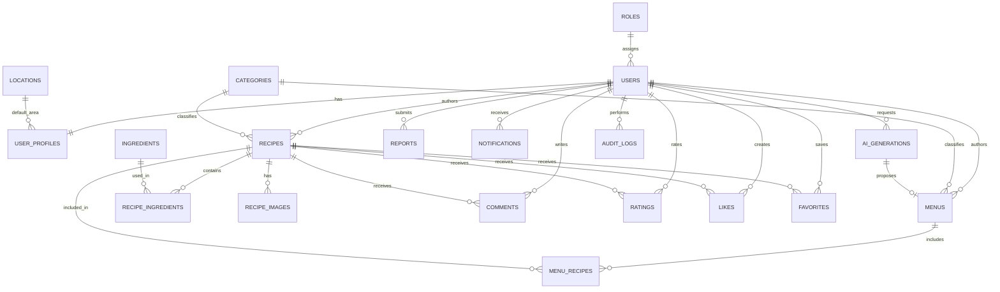

# Recipe Sharing Community System — System Plan

## 1. Project title
Recipe Sharing Community System

## 2. Project background
Home cooks need a single community platform to publish recipes, organize reusable menus, discover recipes contributed by others, and receive practical meal ideas. Existing tools often separate social discovery, content management, and meal planning. This project combines those workflows while keeping authorship, community moderation, location fallback, and human review of AI suggestions explicit.

## 3. Problem statement
Manual recipe discovery and menu planning require repeated searching across disconnected sources and formats. Users need a responsive, secure system that supports publication and drafts, community feedback, favorites, searching, location-aware suggestions, and administrator moderation without presenting AI or location data as guaranteed availability or fact.

## 4. Project objectives
- Provide secure registration, authentication, profiles, and role-based authorization.
- Let users create, edit, publish, draft, delete, and share recipes and menus.
- Support images, categorized ingredients, preparation details, comments, ratings, likes, and favorites.
- Provide searchable, filterable discovery of community recipes and menus.
- Use browser location consent and manual fallback to improve local recipe/menu context.
- Generate structured AI menu suggestions that require review before publication.
- Give administrators tools to manage users, categories, reports, content, and system activity.
- Maintain normalized relational data, validation, security, accessibility, and maintainability.

## 5. Scope and limitations
### In scope
End-user accounts and profiles; recipe/menu authoring; drafts and published states; uploads; discovery and search; community interactions; location preference; configurable AI provider integration; administration/moderation; responsive web UI; MySQL persistence; tests; setup and deployment documentation.

### Out of scope or deferred
Native mobile applications, live marketplace/store inventory, real-time chat, third-party recipe import, service-wide recommendation training, payment processing, delivery services, and a production nutrition analysis service. These may be future enhancements and do not change initial architecture.

### Assumptions and limits
- Browser geolocation supplies coordinates; reverse geocoding or coarse areas require a configured provider and can fall back to manual areas.
- AI availability depends on a configured provider. Generation must degrade gracefully and never publish automatically.
- “Local availability” means ingredients commonly associated with a selected area, not confirmed presence in stores, unless an approved verified inventory source is integrated.
- Initial notification delivery is in-platform only.
- Location precision and retention are minimized; precise coordinates are not required for core recipe features.

## 6. Target users
- Community members seeking recipes, menus, saved favorites, ratings, and feedback.
- Recipe authors managing drafts, published recipes, images, and menus.
- Administrators and moderators managing user/account and community content.
- System maintainers operating configuration, schema migrations, backups, and deployments.

## 7. User roles and permissions
### End user
Can register/login; manage their profile; create, view, edit, publish, draft, and delete their own content; upload accepted images; comment, rate, like, save favorites, report violations; manage consented location; generate and review AI menus; and view notifications.

### Administrator
Has all end-user capabilities for their own account plus access to aggregate dashboards, user status/role management, category management, report queues, moderation actions, activity records, and published/hidden/removed content management. Administration is separated by capability but uses the same authenticated layout and reusable UI components as end-user pages.

### End-user module plan
| Module | Primary workflows | Core persistence | Authorization |
|---|---|---|---|
| Dashboard | Own statistics, drafts, favorites, notifications, recent activity | User-owned aggregates and activity | Authenticated account |
| Recipes | Browse, create, edit, publish, draft, upload images, report | Recipes, recipe ingredients, images, categories | Public read; ownership for writes |
| Menus | Create, order recipes, save drafts, publish | Menus and menu recipe joins | Public read for published; ownership for writes |
| Community | Comment, rate, like, favorite, report, notify | Community joins, reports, notifications | Authenticated writes; public reads where published |
| Discovery | Search, filters, categories, locations, recommendations | Recipe/menu indexes and reference records | Guest and authenticated read |
| AI Menus | Generate, review, regenerate, save draft, explicitly publish | Generated-menu records and owned menus | Authenticated account owner |
| Account | Profile, security, location consent, preferences | Users, profiles, location consent, sessions | Authenticated account owner |

### System-administration module plan
| Module | Primary workflows | Required safeguards |
|---|---|---|
| Admin Dashboard | Platform metrics, growth, unresolved reports, recent moderation, health indicators | Admin only; statistics omit private data |
| User Administration | Search profiles, view status/history, change permitted role/status | Admin only; CSRF; audit; prevent unauthorized self-demotion |
| Content Moderation | Hide/restore/remove recipes and menus; author notice and reason | Admin only; valid state transitions; audit |
| Reports and Complaints | Review target, resolve/dismiss, warn/hide/remove/suspend | Transactional resolution; duplicate-safe actions; audit |
| Community Moderation | Review comments and abuse patterns, remove violations | Admin only; preserve moderation history |
| Taxonomy Management | Create/update/deactivate categories, ingredients, locations, units | Unique names/slugs; usage-aware deactivation; audit |
| AI Oversight | Review generation health/failures and policy flags; provider status | No secret/provider-key exposure; audited config changes |
| Notification Administration | Platform notices, targeted announcements, delivery/read status | Admin only; template validation; audit |
| Audit and Activity | Filter actor/action/target/date; inspect reason and target summary | Admin only; append-only records; privacy-safe payloads |
| System Settings and Operations | Public configuration, maintenance, limits, privacy text, health/backup status | Deployment-sensitive changes server-side; secret values never returned |

### Authorization matrix
| Action | Guest | End user | Admin |
|---|---:|---:|---:|
| Browse published content | Yes | Yes | Yes |
| Manage own drafts | No | Yes | Yes |
| Manage another user's content | No | No | Moderation only |
| Manage own profile and location | No | Yes | Yes |
| Create reports and community interactions | No | Yes | Yes |
| Manage categories/users/reports | No | No | Yes |
| View private audit records | No | No | Yes |

## 8. Functional requirements
1. Registration, login, logout, password change, profiles, account status.
2. Recipe CRUD with categories, ingredients, quantities, units, instructions, times, images, and draft/publish states.
3. Menu CRUD with ordered recipe references and draft/publish states.
4. Public recipe/menu browse, keyword search, filters, sorting, pagination, and profiles.
5. Likes, one rating per user/recipe, comments, favorites, reports, and notifications.
6. Browser location permission, manual fallback, location preference clearing, and location-aware recommendations.
7. Configurable AI menu generation, regeneration, structured validation, review, draft save, and explicit publication.
8. Administrator dashboard, user/account management, report and content moderation, category management, and activity monitoring.
9. Responsive, accessible, reusable front-end components and validation.
10. Parameterized database operations, tests, setup, migration, and deployment procedures.

## 9. Non-functional requirements
- **Usability:** Responsive; semantic and keyboard-accessible; clear feedback and empty states.
- **Performance:** Public discovery should use indexed queries and pagination; target under normal data volumes is a sub-second application response for most pages.
- **Security:** CSRF/session protection, secure password hashing, ownership checks, role checks, upload validation, parameterized SQL, header hardening, and least privilege.
- **Privacy:** Explicit location consent, coarse/retained values only where needed, clear controls, no sensitive AI provider payloads, and sanitized logs.
- **Reliability:** Transactions for related writes, provider/request timeouts, fallback UI, transaction-safe moderation, and tested backups.
- **Maintainability:** Blueprints, services, repositories, centralized validation/status constants, migrations, and automated tests.
- **Compatibility:** Modern desktop/mobile browsers. Browser geolocation requires a secure context except localhost.
- **Availability:** External AI is optional; core application remains usable when unavailable.

## 10. System architecture
### Architecture diagram
```text
Browser
  | HTML/CSS/JS + Geolocation
  v
Flask Application Factory
  +-- Blueprints/routes (HTTP and full-page validation)
  +-- Versioned API routes (JSON, fragments, UI configuration)
  +-- Services (authorization, workflows, dashboard, moderation, AI orchestration)
  +-- Repositories (parameterized MySQL access)
  +-- Jinja partials/layouts/components (direct and SPA rendering)
  +-- Vanilla JS router/API client/progressive enhancement
         |
         +-- MySQL
         +-- File storage (avatars and recipe images)
         +-- AI provider adapter (server-side)
         +-- Optional reverse-geocoding/location adapter
```

A server-rendered Flask architecture keeps browser behavior and page access aligned. The repository layer can use direct MySQL access through a connection abstraction rather than introducing an ORM. External adapters are isolated behind interfaces so provider/API failures can be handled consistently.

### Request flow
1. Flask route validates request format and authentication state.
2. Route/decorator authorizes the action.
3. Service applies domain rules and status/ownership constraints.
4. Repository performs parameterized SQL in transactions when needed.
5. Template JSON/redirect/error response is returned.
6. Browsers show success or accessible field-level errors.

## 11. System workflow
### Registration and publishing
A guest registers; verifies credentials if verification is enabled; logs in; creates profile; creates a recipe/menu draft; saves media/ingredients; publishes explicitly; content becomes visible in discovery.

### Discovery and community
A guest/user browses and searches published content, views details, interacts if logged in, saves favorites, and reports inappropriate content.

### Moderation
A report enters the moderation queue; an administrator reviews it; changes the target status and/or account status; records a resolution and audit entry; and the target is updated in discovery.

## 12. Use case descriptions
### UC-1 Register and log in
Actor: guest. Main path: submit valid details, server creates a hashed-password account, establishes session, returns dashboard. Alternate: validation error or duplicate account. Exceptions: suspended/deactivated status.

### UC-2 Create and publish a recipe
Actor: end user. Main path: enter recipe metadata, ingredients, instructions, category, optional media; server validates and transactionally saves draft; user publishes after review. Alternate: save draft; validation failure. Exceptions: ownership violation or missing required published fields.

### UC-3 Create menu
Actor: end user. Main path: choose title/description and recipes, save draft, review, publish. Alternate: edit draft/delete. Exceptions: duplicate recipe reference or unauthorized owner action.

### UC-4 Discover recipes
Actor: guest/user. Main path: enter keyword/filters; system executes indexed published-only query; user views card/detail. Alternate: zero results or invalid filters.

### UC-5 Community interaction
Actor: end user. Main path: create valid comment/rating/like/favorite/report. Alternate: update/delete own action. Exceptions: duplicate rating/like, moderation restrictions, invalid target.

### UC-6 Location-aware recommendation
Actor: end user. Main path: explain permission, obtain browser coordinates, convert to a coarse area or allow manual area, save consented preference, generate context-aware suggestions. Alternate: permission denied/unavailable/manual selection. Exceptions: provider unavailable, stale/inaccurate location.

### UC-7 AI menu generation
Actor: end user. Main path: configure preferences, submit request, server invokes provider, validates response, stores reviewable draft, user edits/regenerates/publishes. Alternate: provider unavailable. Exceptions: invalid output, timeout, rate limit.

### UC-8 Moderate report
Actor: administrator. Main path: open report, inspect target and history, choose resolution/action, transactionally update content/account/report/audit. Alternate: dismiss or request more review. Exceptions: authorization failure, already resolved report, target removed.

## 13. Database design and relationships

### Core tables
- `roles`: role identifier and name.
- `users`: credentials/status; role foreign key.
- `user_profiles`: user extension; display name, bio, avatar, location preference.
- `categories`: shared recipe/menu categories.
- `ingredients`: normalized ingredient names and approval state.
- `recipes`: authored content and draft/published state.
- `recipe_ingredients`: recipe to ingredient with quantity/unit/order.
- `recipe_images`: uploaded image metadata and primary flag.
- `menus`: authored menu and draft/published state.
- `menu_recipes`: menu-to-recipe ordered join relation.
- `comments`: nested recipe feedback.
- `ratings`: one rating per user/recipe.
- `likes`: one user/recipe like.
- `favorites`: one user/recipe saved item.

### Moderation/community tables
- `reports`: report target, reporter, reason, status/resolution.
- `notifications`: recipient, type, payload reference, read state.
- `audit_logs`: administrator or privileged actor action and target metadata.

### Location and AI tables
- `locations`: coarse selectable area and optional parent/region/country data.
- `user_locations` or a profile location foreign key: consent/source/coordinates or selected area. Precise coordinates should be short-lived or omitted when not required.
- `ai_generations`: owner, request, provider, status, output/draft/menu relationship, generated timestamp.
- `ai_generated_menus`: structured persisted suggestion associated with reviewable menu.

### Integrity rules
- `users.role_id` references `roles`; passwords are hashes, never plaintext.
- Content has an `author_id` foreign key and status/check constraint.
- Recipe/menu author may update only through ownership authorization.
- RecipeIngredient has unique recipe/ingredient/order constraints as appropriate and cascade behavior on recipe deletion.
- One user/recipe row exists in ratings, likes, favorites.
- Comments link to recipes/users and optional parent comment.
- Reports link reporters and targets through either normalized target tables or approved polymorphic keys with application validation and target integrity policies.
- Deletes for authored content preserve moderation/audit records according to policy; FK behavior should be explicit.
- Critical indexes include recipe status/category/author/created date; ingredient joins; menu joins; published discovery; reports status; and notification recipient/read state.

### ERD


## 14. Folder structure
See the implemented package layout below. Existing application code and documentation must be preserved and organized rather than overwritten.

```text
recipe_share/
├── app.py
├── requirements.txt
├── pyproject.toml
├── .env.example
├── README.md
├── config/
├── database/
│   ├── schema.sql
│   ├── migrations/
│   └── seeds/
├── docs/
│   ├── GEMINI.md
│   ├── Roadmap.md
│   ├── API.md
│   └── SystemPlan.md
├── tests/
└── recipeshare/
    ├── __init__.py
    ├── extensions.py
    ├── shared/
    ├── auth/partials/
    ├── home/partials/
    ├── users/partials/
    ├── recipes/partials/
    ├── menus/partials/
    ├── community/partials/
    ├── location/partials/
    ├── ai/partials/
    ├── admin/partials/
    ├── templates/
    │   ├── layouts/
    │   ├── partials/
    │   └── components/
    └── static/
        ├── css/
        ├── js/components/
        └── uploads/
```

Feature modules are composed from routes, services, repositories, templates, and feature partials. Shared layout and reusable UI components are stored separately and must not embed database/business logic. Every page is assembled from partials so SPA view transitions can reuse the same presentation components as direct page loads.

## 15. Frontend page structure and application layout
The UI follows the approved visual direction shown by the reference screens: a bright cream and green RecipeShare brand palette, food photography in cards, restrained orange highlights, generous white content surfaces, a public marketing/discovery layout, and role-specific authenticated shells.

### Public shell
- Full-width responsive top navigation with the RecipeShare brand, discovery links, search, login, and registration actions.
- Landing page hero with a real food-image background, searchable discovery control, category shortcuts, featured and popular recipe cards, and community callouts.
- Login and registration screens use the same split branded layout, reusable form-field components, server-side validation feedback, and accessible password controls.
- Public discovery uses cards and filters for recipes, categories, menus, and location-based results; recipe detail uses an ordered content layout for media, author, metadata, ingredients, and instructions.

### Authenticated application shell
- Fixed desktop side navigation and a responsive mobile drawer/menu.
- Shared top application bar with global search, notification indicator, location indicator, profile summary, and logout action.
- Main content area renders dashboard widgets, inventory/statistics, recipe grids, ranked lists, management tables, forms, and recent activity.
- The screenshot's dark green sidebar, white cards, soft borders, and emerald/rose metric accents are the visual baseline. Dark green is reserved for navigation and primary actions; warm food photography supplies the visual emphasis.
- Administrator inventory, user management, moderation, category, and activity views use the same shell and reusable table/stat/list components rather than a separate visual system.

### Reusable UI component inventory
- Brand/header/navigation, desktop sidebar, mobile navigation, user menu, global search, notification badge.
- Button, icon button, text input/select/text area, checkbox, validation field, form section, and form error summary.
- Recipe card/menu card, feature card, category tile, author chip, rating block, favorite/like controls, media gallery, and image upload dropzone.
- Metric card, chart panel, ranked-list panel, inventory toolbar, content table, status badge, pagination, empty/loading/error states, alert/flash, location prompt, confirm modal, and toast.
- Navigation, component state, sort order, labels, icons, and skeleton/empty messages must not be duplicated across pages as unrelated strings or markup.

### SPA behavior
The application remains server-rendered for direct navigation, SEO, and no-JavaScript fallback. Vanilla JavaScript progressively enhances the same partial-based Flask views into a client-side SPA:
- `spa-router.js` handles History API navigation for internal application links and does not replace Flask routes.
- The server supplies page metadata, partial HTML, and API data through shared service/repository contracts.
- `GET /api/v1/ui/navigation` supplies the role-aware navigation model. Route and component decisions are made from server-backed configuration, not hardcoded user role or page lists in JavaScript.
- Page fragments may be requested from the same API as full endpoints; endpoints identify a response variant with a documented partial/request mechanism.
- SPA transitions preserve layout chrome, swap only the main content region, update document title/meta, restore page focus, and support browser Back/Forward navigation.
- Loading skeletons are shown during transitions; timeout, authorization, not-found, network, validation, and empty states use shared reusable partials.
- Forms are progressively enhanced with existing browser submission and validation when JavaScript is unavailable. State-changing SPA requests include the same CSRF token and are handled by the same API validation rules as full requests.

### Functional data rules
No recipe, menu, category, dashboard statistic, ranked list, chart series, location, notification count, profile, admin action, or navigation item may be permanently embedded in templates solely for visual display. Seed/demo records may populate development data, but presentation reads database-backed service results through repositories. Stable numeric constants include pagination size, limits, upload constraints, chart dimensions, and configuration defaults—not business records. An empty database must render empty states rather than retaining visual placeholder recipes or users.

### Responsive and accessibility rules
The public shell collapses navigation at the mobile breakpoint. The authenticated desktop sidebar becomes an accessible drawer, statistic cards stack, recipe grids reduce columns, tables become scrollable or transform into list/card layouts, and dashboard ranking panels move below primary content. Include visible focus, keyboard-operable controls, skip navigation, live announcements, meaningful image alternative text, color-independent status information, minimum touch targets, and sufficient contrast.

## 16. Backend module structure
- `auth`: sessions, credentials, password change, authorization decorators.
- `users`: profile and account operations.
- `recipes`: recipe domain/workflows/repository/routes.
- `menus`: menu domain/workflows/repository/routes.
- `community`: comments, ratings, likes, favorites, reports, notifications.
- `categories`, `ingredients`: catalog and autocomplete operations.
- `location`: consent and manual area selection.
- `ai`: provider adapter, prompt schema, output validation, generation orchestration.
- `admin`: dashboard, account/content moderation, reports, category and activity views.
- `models`: simple domain and row mapping definitions if they improve consistency; persistence remains repository-owned.
- `templates/static`: server rendering and progressive enhancement assets.

## 17. Recipe and menu management workflow
1. Validate and normalize author input.
2. Create draft with owner association and draft status.
3. Add ingredient join rows, instructions, optional category and images.
4. Validate required fields for publish.
5. Transition to published only on explicit user action and valid service state.
6. Transactionally update published relationships and invalidate relevant caches/lists.
7. Ownership-protect edit/delete/status operations.
8. Preserve moderation/an audit history where required; do not hard-delete records needed for accountability.

Menu workflow follows the same status lifecycle and requires ordered recipe references. AI-generated menus may enter as special-generation records linked to reviewable drafts.

## 18. Location detection workflow
1. Explain why location is requested and obtain browser permission.
2. On success, use coordinates only to resolve a coarse supported area or derive a privacy-preserving recommendation context.
3. Present manual location search as fallback for denial, timeout, or unavailable data.
4. Store consented preference and data source/scope, not a high-precision coordinate by default.
5. Let the user change/clear location.
6. Use location in search/AI only with an enabled preference and documented provider availability.
7. Treat recommendations as suggestions. Do not claim store inventory without a verified source.

## 19. AI-generated menu workflow
1. Collect explicit preferences and coarse location context.
2. Build a provider-neutral prompt and a strict schema for titles, ingredients, quantities, instructions, and assumptions.
3. Send server-side credentials through the AI adapter with timeout/retry/rate-limit policy.
4. Validate output types, required fields, duplicates, and unsafe/unreasonable values.
5. Store generation metadata and create a reviewable draft menu.
6. Render assumptions and allow editing/regeneration.
7. Require explicit save/publish action; publication is validated by normal menu rules.
8. On provider/schema failure, offer a clear retry or manual authoring fallback.

## 20. Security and privacy considerations
- Strong adaptive password hashes, secure session cookies, CSRF protection, login abuse controls.
- Ownership and role checks before content/profile/admin mutations.
- Parameterized SQL and strict request/JSON/form validation.
- Escape template data; sanitize rich-text only through an explicitly approved policy.
- Validate upload MIME, decoded type, size, dimensions where applicable; generated filenames and controlled storage.
- Secure location permission and minimize stored precision; support clearing preferences.
- Provider API keys stay server-side; AI prompts avoid secrets and unnecessary personal data.
- Audit privileged actions; logs exclude passwords, tokens, body secrets, precise location, and sensitive personal data.
- Security headers, TLS in production, dependency updates, backups, and recovery procedures.
- Privacy/terms disclosures should be reviewed before production collection of location or additional personal information.

## 21. Testing strategy
### Automated
- Unit tests for services, validation, status transitions, image/path utility, location privacy, and AI schema handling.
- Repository/integration tests for constraints, transactions, pagination, ownership, and query safety.
- Flask route tests for login, roles, CSRF, validation, error contracts, file uploads, ownership, API responses, and admin permission boundaries.
- Database tests on clean schema plus migration/seed upgrade cases.
- Browser/end-to-end tests for registration, recipe/menu draft-to-publish, discovery, community interactions, location fallback, AI mocked success/failure, and administration.

### Manual/accessibility
- Responsive browser and keyboard review.
- Screen-reader labels, focus order, status announcements, and contrast.
- Permission-denied geolocation, provider outage, upload failure, moderation, and malformed request/error states.

### Release gates
- Each roadmap phase has passing targeted tests before advancement.
- Full suite passes before deployment.
- No unresolved critical/high security, data integrity, or authorization findings.
- Clean database migration and smoke check; backup and rollback procedure completed.

## 22. Future enhancements
- Verified local inventory/retailer integrations.
- Recipe import from approved sources and structured recipe import.
- Nutrition/allergen estimation with a vetted source and clear confidence.
- Meal planning calendars and shopping-list generation.
- Personalization based on consented preferences and measured feedback.
- Real-time notifications and optional email delivery.
- Internationalization, currency/unit localization, and richer location provider support.
- Image moderation and provider-independent moderation queues.
- Analytics dashboards with privacy-preserving aggregation.

## Approval checkpoint
Do not begin application implementation until these four documents have been reviewed and approved. Phase 1 may begin only after the user authorizes development to proceed.
